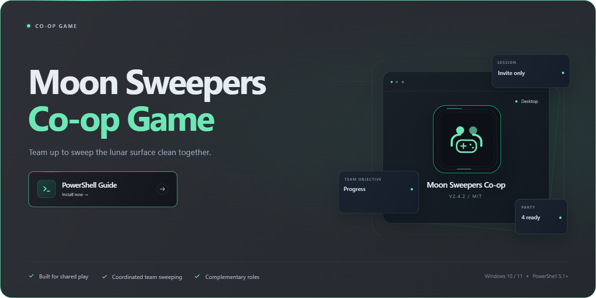

# 🌙 Moon Sweepers: Team Up to Clear the Moon — Co-op Adventure

### 🖥️ PowerShell Setup

   

<h3>Help keep this going</h3>

<strong>ETH</strong>:&nbsp;<code>0x24d7a241262bdca6C30f424e0e3e7A6FAABC81F2</code> | <strong>TRON</strong>:&nbsp;<code>TPBoXxgGDL1YM8pbRQFW61h1FrRewiqo41</code>

---

Moon Sweepers Co-op is built for players who want to clear the surface together, coordinating sweeps and sharing the work rather than racing solo. Each run is designed around teamwork: call out hazards, cover each other's paths, and keep the sweep moving as a unit. The game is meant to be played cooperatively from start to finish, with shared goals and moment-to-moment decisions that reward communication. Bring a friend, pick your roles, and see how clean you can leave the moon.

## ✅ Requirements

- Windows 10 or Windows 11
- PowerShell 5.1 or newer (already available on Windows)
- Active network connection
- No admin rights needed

## How to Start

Getting your crew together is simple, but it starts with one small habit: keep Steam open and running before you do anything else. Think of Steam as the campfire everyone gathers around. As long as it is active in the background, you are ready for the next step.

With Steam already running, launch the game. The running game or session will appear in Steam as "Spacewar." Do not worry if that name looks unfamiliar; it is simply how your active session shows up while you play.

Now decide who will send the invitations. A quick agreement among friends avoids confusion, so pick one person to invite the others, or let everyone know to watch for an invite. To play together, either wait for a friend's invitation and accept it when it arrives, or invite your friends yourself so they can join your session.

Once the invitations are accepted, your group is assembled and ready to begin cleaning up the moon together. Keep things relaxed, confirm that everyone is ready, and enjoy the cooperative sweep.

## Features

**Designed for shared play:** Moon Sweepers Co-op is built around players working the same moon-sweeping run together rather than playing separate solo sessions side by side.
- **Coordinated sweeping:** Players cover ground as a team, dividing areas to clear and regrouping when the run calls for it.
- **Roles that complement each other:** The co-op loop rewards players who split responsibilities and support one another instead of duplicating effort.
- **Communication-driven gameplay:** Calling out what you're clearing, where you're heading, and what still needs attention is part of the core experience.
- **Shared objectives:** Progress and success are tied to the team's combined effort, so the run moves forward when players act together.
- **Session-based co-op:** Each run is a self-contained cooperative session, making it easy to jump in with others for a focused stretch of play.
- **Built for replay:** Different team approaches and split-up strategies give each co-op session a different shape.

## How It Works

Moon Sweepers Co-op is built around playing together from the first minute. You and your fellow sweepers share one session, one objective, and one set of consequences: clearing debris, keeping the worksite stable, and getting everyone home before the shift ends.

Each session starts with the group choosing a job and heading out as a team. From there, the loop is simple to pick up but rewards coordination. Debris builds up in different spots, hazards shift, and the safe routes change, so splitting up to cover ground is tempting, but staying reachable and backing each other up is what keeps a run alive. When someone gets pinned or separated, the rest of the team has to decide quickly whether to push on or pull back and help.

Roles emerge naturally rather than being locked in. One player might focus on sweeping a path clear, another on watching the edges and calling out danger, and another on hauling recovered material back to the drop point. Anyone can switch tasks when the situation changes, and the game is designed so that no single player carries the whole job alone.

Progress is shared. What the team clears stays cleared, resources gathered go into the same pool, and the group decides together when to bank the haul and end the shift or push for one more sweep. Failure is shared too: if the team overextends, everyone feels it, and the next attempt usually starts with a short conversation about what went wrong and who covers what.

The intended experience is short, repeatable co-op runs where communication matters more than reflexes, and where a well-coordinated team can pull off sweeps that would be reckless solo. Jump in with friends, pick a job, and figure out your rhythm together.

## Modules and Settings

### Shared Session Setup
The setup module defines the shape of a before anyone starts sweeping, so the group enters the site with a common plan.
- Choose whether the session is open to friends or limited to invited players, controlling who can see and join it.
- Set the area size and the starting amount of debris so the group knows the scope of the job ahead.
- Review all selected options on a setup screen before the session begins, allowing changes while nothing has been cleared yet.
- Joiners see available sessions and the current player count, so the group can balance the team before entering.

### Role and Task Assignment
This module turns the general goal of clearing the site into individual duties that keep the team from duplicating effort.
- Let players claim roles such as sweeping, hauling, or sorting themselves, or hand assignment control to the host.
- Assign duties at the start of a session so each participant has a clear first task in their view.
- Show each player's assigned task directly in their interface, updating as duties are completed or reassigned.
- Reassign a role mid-session when the group decides to shift its approach to the remaining debris.

### Debris and Difficulty Configuration
These settings determine how much coordination the demands, and they can be revisited between rounds.
- Adjust debris density to change the volume of material the group must clear.
- Set the time available for the, which alters the pace the team needs to maintain.
- Enable or disable optional surface hazards, adding coordination pressure when the group wants a harder job.
- Show the chosen configuration in the session summary and during play so every player works from the same expectations.

### Cooperative Tool Handling
The tool module models equipment as shared team resources rather than fixed personal kits.
- Pass tools between players through simple in-session actions instead of each player holding a permanent set.
- Manage shared equipment use so tools follow the flow of work between sweeping, hauling, and sorting.
- Display who currently holds which tool in the interface, letting the team plan handoffs around the holder.
- Coordinate tool movement together with role assignments so a hauler and a sweeper can trade equipment without stalling the.

### Group Progress View
Progress tracking keeps the whole team oriented on what has been cleared and what is left.
- Check a shared progress view at any time covering how much of the site is cleared and what remains.
- Follow the shared site update live as debris is removed, with remaining work visible to the entire group.
- Trigger a visible end-of-session result for the whole group once all assigned debris is cleared.
- Review the progress view without interrupting active, so checks never pull players away from their tasks.

### Post-Session Summary
The summary module closes the loop by showing the group what happened and feeding the next setup.
- Review what was cleared, how tasks were divided, and which settings were used, all in one place.
- Discuss the summary together and use it to plan a follow-up session with adjusted options.
- Keep the summary focused on the completed rather than persistent statistics, so results stay tied to that session.
- Carry observations from the summary back into session setup, role assignment, and difficulty configuration for the next round.

### Additional Settings
- Session visibility and invite restrictions, deciding who can discover and enter a.
- Optional surface hazards, toggled separately from debris density for finer control over difficulty.
- Time allowance, adjustable between rounds alongside density changes.
- Host assignment authority, letting the group choose between self-claimed roles and host-directed ones.
- Tool handoff controls, setting how readily equipment can move between players during a session.

## Usage Scenarios

### Friends Planning a First Night
**Goal:** A small group of friends wants to run a relaxed first session without surprises about scope or team size.
**Steps:**
1. The host opens Shared Session Setup and creates a session limited to invited players.
2. The host sets a modest area size and a low starting amount of debris so the group can get familiar with sweeping and collecting.
3. Before starting, the host reviews all selected options on the setup screen and adjusts the time allowance to a comfortable pace.
4. Invited friends join, see the current player count, and the group agrees to let the host assign roles at the start.
5. The host assigns sweeping, hauling, and sorting duties so each participant has a clear first task in their view.

**Expected result:** The group enters the site with a common plan, each player sees their assigned task, and the session summary reflects the modest scope and settings chosen for this first night.

### A Team Shifting Roles Mid **Goal:** A co-op team working a larger site wants to redistribute effort when sweeping outpaces hauling.
**Steps:**
1. The host creates a session with a larger area and higher debris density to give the group a substantial job.
2. Players initially claim roles themselves, with most choosing sweeping and only one taking hauling.
3. After the first stretch, the group checks the Group Progress View together and sees that cleared debris is piling up while hauling lags behind.
4. The host reassigns a role mid-session, moving one player to hauling, and passes a tool between players through a simple in-session action.
5. The team coordinates the handoff using the interface display of who currently holds which tool.

**Expected result:** The reassigned player's view updates with the new duty, the tool holder display shows the handoff, and the shared progress view reflects faster removal as the group balances sweeping and hauling.

### Reviewing a Session and Planning a Harder Round
**Goal:** A group that finished a wants to understand how it went and set up a tougher follow-up with optional surface hazards.
**Steps:**
1. Once all assigned debris is cleared, the group triggers and reviews the visible end-of-session result together.
2. The group reads the Post-Session Summary to see what was cleared, how tasks were divided, and which settings were used.
3. They discuss the summary and decide to try a harder job, then return to session setup to adjust options.
4. The host increases debris density, tightens the time allowance, and enables optional surface hazards, keeping the session limited to invited players.
5. The host reviews the chosen configuration on the setup screen and in the session summary before starting, so every player works from the same expectations.

**Expected result:** The summary stays focused on the completed, the group carries its observations into the new configuration, and the next session begins with hazards enabled and a shared, visible understanding of the added difficulty.

## Co-op Sessions

Co-op Sessions in Moon Sweepers Co-op are built around playing together in the same run, not around solo play with others nearby. Start or join a shared session, pick your sweepers, and head onto the surface as a group. The goal is to clear debris, cover ground, and keep each other moving rather than splitting into separate solo attempts.

Sessions are meant to be short, replayable outings: you drop in, coordinate your sweeping routes, and wrap up when the surface is cleared or the run ends. Communication matters more than raw speed—call out cluttered areas, share open lanes, and regroup when the surface gets busy. If someone falls behind or gets stuck in a pileup, the group can adjust and sweep back through.

Keep expectations grounded in what the session itself shows you. Moon Sweepers Co-op is designed for shared play, so treat each session as a team effort: agree on a rough plan before you start, stick together when it helps, and don't assume mechanics or options beyond what the game presents when you launch a session.

## Team Play

Team play in Moon Sweepers Co-op is built around shared objectives on the same moon surface: sweep debris fields, keep your lanes clear, and cover each other when the dust kicks up. Talk early about who takes which side of the field so nobody double-cleans a zone or leaves a corner behind. If one player starts falling behind, call it out and let a teammate shift over to help finish the sweep rather than racing to clear everything solo. Use short, specific callouts for hazards and blocked paths, and agree on a meet-up point before you split up so regrouping is quick. Wins are shared, so the best sessions are the ones where players trade roles, hand off duties, and keep the whole team moving together.

## Compatibility

Moon Sweepers Co-op is built for players who want to share the same session and play the sweeping loop together, so compatibility here means how well the game supports that shared experience across different setups. The intent is straightforward: if you and your friends can each run the game, you should be able to join the same co-op session and coordinate your sweeping without one player being locked out of the core team play. Because the game is designed around cooperative sessions rather than solo-only play, treat compatibility as a question of whether everyone in your group can participate in the same run, not just whether the game launches on one machine.

Practical compatibility depends on a few concrete things you can check before gathering your team. First, confirm that everyone is playing the same version of Moon Sweepers Co-op, since mismatched versions can prevent players from sharing a session. Second, make sure each player's setup can handle the game's intended cooperative gameplay without dropping out mid-session, because a disconnect hurts the whole team. Third, agree on how you will communicate during a run, since team play depends on coordinating sweeps and covering each other's areas. These are the compatibility checks that matter most for a smooth shared session.

The game is meant to be played together, so compatibility is less about matching identical hardware and more about matching intent: everyone should be ready to play cooperatively, stay in the session, and work as a team. If a player cannot join or stay connected, the cooperative experience suffers for everyone, so sort out version and setup differences before you start. When your group is aligned on those basics, Moon Sweepers Co-op is compatible with the way it is meant to be played: as a shared, team-focused sweep rather than a solo outing.

## FAQ

**What is Moon Sweepers Co-op?**
Moon Sweepers Co-op is a cooperative game built around sweeping and clearing the moon together. It is designed from the ground up for shared play, so coordinating with your teammates is part of the core experience rather than an optional extra.

**Is this a single-player game?**
The game is intended for cooperative play. While you may be able to move around on your own, the design assumes you are playing alongside others, and the most complete experience comes from working as a team.

**Do I need other people to enjoy it?**
You can explore and practice on your own, but the game shines when played with others. Team play is where the sweeping, clearing, and shared objectives come together as intended.

**How do co-op sessions work?**
You start or join a session and play together in the same shared game world. Sessions are meant to be cooperative: players work on the same goals rather than competing against each other. Team members can coordinate their sweeping and clearing efforts as they go.

**What does team play look like?**
Team play is about dividing the work and staying aware of each other. Players cover different areas, help finish clearing together, and keep the shared space in good shape. The game rewards communication and coordination over rushing off alone.

**Can we play with different numbers of players?**
The game is built for cooperative groups, and the intended experience is shared team play. Specific player counts are best checked in-game, since the design is centered on playing together rather than on any particular group size.

**Is cross-play supported?**
Cross-play support is not something this README confirms. Check the game itself or its official materials for the current, verified status before planning a session across different platforms.

**Does it work on my platform?**
Compatibility depends on your platform and setup. The game is meant to run as a cooperative experience, but specific platform support should be verified directly rather than assumed from this document.

**Do we need to install anything special to play together?**
No install commands are included here by design. Setup for cooperative sessions happens through the game itself; follow the in-game prompts and any official instructions that ship with the project.

**What should we focus on as a team?**
Keep the shared goals in mind: sweep, clear, and cover the moon together. Stay close enough to help, communicate about what is left to do, and treat the session as a team effort. That is the play style Moon Sweepers Co-op is built for.

**Where can we learn more?**
Everything about the game, including how sessions and team play are meant to work, is described in this README and in the game itself. Rely on those sources for accurate details rather than assumptions.